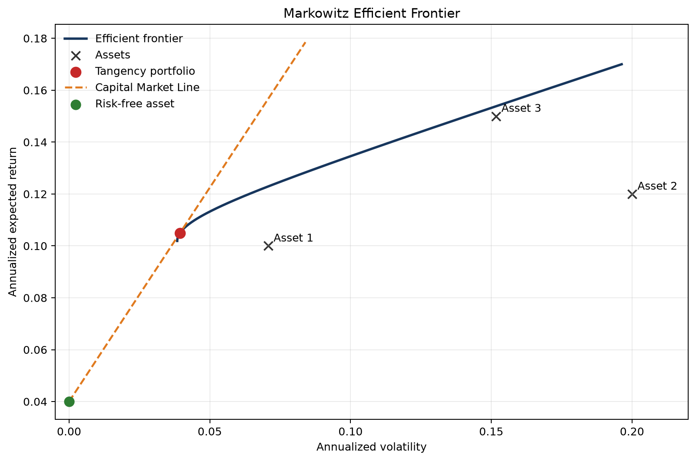

# Markowitz Portfolio Optimization

A reproducible Python implementation of unconstrained Markowitz mean-variance
optimization using either synthetic inputs or historical market data.

The project separates the mathematical optimization layer from market-data
download and visualization. It includes the global minimum-variance portfolio,
the efficient frontier, the tangency portfolio, portfolios that combine risky
assets with a risk-free asset, and an empirical CAPM comparison against an
observed market index.

## Features

- Global minimum-variance portfolio
- Minimum-variance portfolio for a target expected return
- Efficient frontier containing only the efficient upper branch
- Tangency portfolio and Capital Market Line
- Risk-free and risky-asset allocation for a target return
- Historical prices and Treasury-yield data from Yahoo Finance
- Empirical beta calculated against the S&P 500 rather than an internally
  constructed portfolio
- Automated validation and unit tests
- Reproducible example figures

## Mathematical model

For expected returns `mu`, covariance matrix `Sigma`, and portfolio weights
`w`, the risky-asset optimization problem is

```text
minimize       w.T @ Sigma @ w
subject to     1.T @ w = 1
               mu.T @ w = target_return
```

The global minimum-variance portfolio is

```text
w_gmv = Sigma^(-1) 1 / (1.T Sigma^(-1) 1).
```

When a risk-free asset is available, the tangency portfolio is proportional to

```text
Sigma^(-1) (mu - risk_free_rate * 1).
```

The implementation uses `numpy.linalg.solve` instead of explicitly computing a
matrix inverse.

## Installation

Python 3.10 or newer is recommended.

```bash
python -m venv .venv
source .venv/bin/activate
python -m pip install --upgrade pip
python -m pip install -e ".[market,dev]"
```

The core package requires NumPy and Matplotlib. The `market` extra installs
Pandas and yfinance, while the `dev` extra installs Ruff.

## Quick start

Run the deterministic synthetic example:

```bash
python examples/synthetic_example.py
```

The command prints the principal portfolio weights and saves
`outputs/efficient_frontier.png`.

Run the historical-data example:

```bash
python examples/yahoo_finance_example.py
```

That example downloads adjusted prices for five stocks, uses `^GSPC` as the
market benchmark, estimates an average 13-week Treasury-bill yield from `^IRX`,
and compares historical mean returns with CAPM-implied returns.

## Example output



## Repository structure

```text
markowitz-portfolio/
├── README.md
├── pyproject.toml
├── .gitignore
├── LICENSE
├── src/markowitz/
│   ├── __init__.py
│   ├── optimization.py
│   ├── data.py
│   ├── metrics.py
│   └── plotting.py
├── examples/
│   ├── synthetic_example.py
│   └── yahoo_finance_example.py
├── tests/
│   ├── test_optimization.py
│   └── test_validation.py
└── outputs/
    └── efficient_frontier.png
```

## Testing and style checks

```bash
python -m unittest discover -s tests -v
ruff check .
```

The tests verify budget constraints, target returns, the tangency solution,
the risk-free allocation, the efficient branch, and invalid covariance inputs.

## Assumptions and limitations

- The analytical solutions permit short selling.
- Borrowing and lending at the risk-free rate are permitted where applicable.
- Transaction costs, taxes, liquidity, and position limits are ignored.
- Historical arithmetic mean returns and covariance are estimates, not
  forward-looking forecasts.
- The average `^IRX` yield is only a practical proxy for the risk-free rate.
- Sample mean returns are noisy and can produce unstable or extreme portfolio
  weights. A production model should consider shrinkage, robust estimation,
  constraints, and out-of-sample evaluation.
- CAPM-implied and historical returns can differ substantially; the comparison
  is descriptive rather than an investment recommendation.

## Possible extensions

- Long-only and bounded optimization with SciPy
- Covariance shrinkage and regularization
- Rolling-window backtesting
- Transaction costs and portfolio turnover
- Out-of-sample performance evaluation
- Command-line arguments for tickers and date ranges

## License

This project is available under the MIT License.
